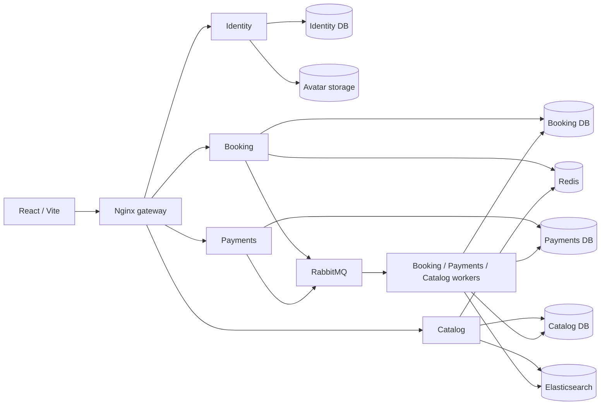

# TicketChain

**Live site:** [ticketchain-94z.pages.dev](https://ticketchain-94z.pages.dev/)

A concert-ticket booking demo with city-based discovery, organizer tools, profile photos, atomic reservations, payments, refunds, and QR check-in. Built with React, TypeScript, Express, and PostgreSQL. Payments use simulated INR by default; Razorpay test mode and Aptos testnet are optional.

The live site uses the same core UI with a lightweight Supabase backend, hosted on Cloudflare Pages. The microservice architecture below describes the full project.

## Architecture



| Service  | Owns                                                                   |
| -------- | ---------------------------------------------------------------------- |
| Identity | Accounts, sessions, OAuth, profile photos, and signing keys            |
| Booking  | Events, tiers, inventory, holds, orders, tickets, and admission        |
| Payments | Provider operations, payment verification, refunds, and reconciliation |
| Catalog  | Discovery projections, search indexing, and caching                    |

Each service has its own PostgreSQL database and credentials. Services communicate through authenticated internal HTTP and RabbitMQ; workers access their owning service's data. Booking transactions prevent overselling. Transactional outboxes and idempotent consumers make asynchronous payment and ticket processing durable. Search is eventually consistent; Booking remains the inventory authority.

The demo runs on **one server, with one container per API and worker**, plus separate infrastructure containers. Public hosting adds Caddy for HTTPS and separate service images. An optional Compose override demonstrates API/worker replicas. See [detailed architecture](docs/ARCHITECTURE.md).

## Run locally

Requires Docker with Compose:

```bash
docker compose up -d --build
```

Open **http://localhost:8080**. Sign in with `attendee@demo.ticketchain.local` or `organizer@demo.ticketchain.local`; both local demo accounts use `TicketChain!2026`. Startup applies migrations and seeds fictional events. Named volumes preserve data across restarts.

For Node.js 22+ development and scaling, see [development setup](docs/DEPLOYMENT.md). For a free VM with HTTPS and generated credentials, follow [single-server demo hosting](docs/DEMO_HOSTING.md).

## Repository layout

```text
apps/web/                React UI and Nginx gateway
apps/api/src/services/   Identity, Booking, Payments, and Catalog modules
apps/api/prisma/         Database schema and migrations
apps/api/scripts/        Bootstrap, cleanup, deployment, and recovery tools
packages/shared/        Client/server contracts and validation
packages/blockchain/    Optional Aptos integration and Move contracts
infrastructure/         HTTPS gateway and image-storage configuration
tests/                  Unit, integration, service, and browser tests
```

## Checks and operations

```bash
npm ci
npm run db:generate -w @ticketchain/api
npm run build
npm run lint
npm run typecheck
npm test
```

See [validation](docs/VALIDATION.md) for database and browser tests, [demo verification](docs/demo-hosting-verification.md) for deployment results, and [database cleanup](docs/database-cleanup.md) for guarded reset/user-removal commands. API contracts are in [OpenAPI](docs/openapi.json).


