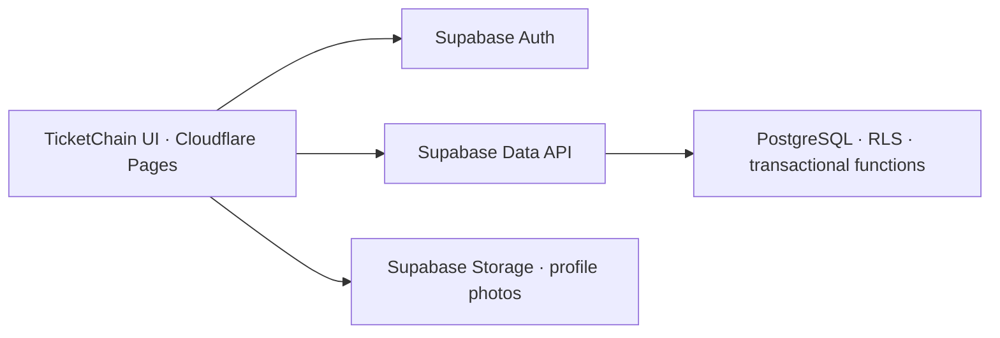

# TicketChain — free hosting edition

The main TicketChain UI, backed by Supabase Auth, PostgreSQL and Storage. Includes discovery, event details, profiles, organizer editing, multiple ticket tiers, bookings, refunds, admission QR codes and check-in. Online payments are not collected; blockchain issuance and waiting rooms are excluded. All UI branding is TicketChain.



`src/features` holds screens and field groups copied from the main UI; `src/backend` adapts its requests to Supabase; `src/contracts` holds validation, cities, timezone and money helpers; `src/styles` preserves the original CSS in small modules. The package is independent of the main microservices.

## Supabase setup

For a new free project, run SQL files **01 through 07** in order in its SQL Editor. For the previously configured project, run only these additive updates, in order:

1. [04-ui-schema.sql](supabase/04-ui-schema.sql) — event metadata, tiers, tickets and preservation of existing bookings.
2. [05-ui-events.sql](supabase/05-ui-events.sql) — organizer save operations and inventory protections.
3. [06-ui-booking.sql](supabase/06-ui-booking.sql) — bookings, refunds and event transitions.
4. [07-ui-account.sql](supabase/07-ui-account.sql) — check-in, summaries and profile-photo storage.

These updates preserve IDs, orders and stock; repeating them does not replenish inventory. Old write operations are retired after the new ones are installed. Run `npm run check:backend` to verify that the new operations are installed and deny anonymous access. The publishable key cannot execute SQL migrations.

## Run locally

Install Node.js 22+, then:

```sh
cd demo-lite
npm ci
cp .env.example .env.local
# Set the Supabase project URL and publishable key in .env.local.
npm run dev
```

Open http://localhost:4175. Use a publishable key or legacy `anon` key, never a secret or `service_role` key. The existing `.env.local` already contains the supplied project configuration; preserve it when continuing local work.

In Supabase **Auth → URL Configuration**, set Site URL to `http://localhost:4175` and allow `http://localhost:4175/login`, `http://127.0.0.1:4175/login` and the corresponding `/profile` URLs for provider callbacks. Email confirmation requires a real confirmed account. Google/GitHub buttons activate only when those providers are configured.

## Deploy

Use **Cloudflare Pages Free + Supabase Free**. No Docker host or Git push is required. See [Cloudflare plans](https://www.cloudflare.com/plans/) and [Supabase limits](https://supabase.com/pricing); inactive Supabase projects may pause after one week.

1. Run `npm run build` with the hosted Supabase configuration in `.env.local`.
2. Create a Pages project using **Direct Upload** in Cloudflare **Workers & Pages**. Upload `dist/`, including `_headers` and `_redirects`. [Upload guide](https://developers.cloudflare.com/pages/get-started/direct-upload/)
3. Set Supabase's Site URL to the resulting HTTPS `*.pages.dev` address and add its `/login` and `/profile` redirect URLs.
4. Verify registration, profile, publication, booking and refund. Rebuild and upload again after configuration or code changes.

## Checks and backups

`npm run build` includes TypeScript validation. `npm test` checks exact money conversion. Local database/browser checks use an isolated disposable stack and a separate Vite mode on port 4185:

```sh
docker compose -f tests/compose.yaml up -d --wait
node tests/setup-local.js --integration
npm run test:database
npx playwright install chromium
npm run test:browser
docker compose -f tests/compose.yaml down
```

The ignored `.env.integration.local` keeps test configuration separate from the hosted project. Browser fixtures are removed in `finally` blocks. Storage metadata is emulated in SQL for database checks; actual photo uploads use hosted Supabase Storage.

Export PostgreSQL and copy the profile-photo bucket before significant changes. Rebuilding the site does not back up accounts or bookings. Photos are cropped, decoded, resized and stripped of metadata in the browser; Storage enforces authentication, folder ownership, WebP MIME type and size. This lightweight backend does not perform server-side image decoding.

Images and the microphone asset retain the main project's [asset credits](../docs/ASSETS.md). Microphone by [Helindu](https://sketchfab.com/3d-models/microphone-a02d9505b3434adf84bc01bea7af4548), [CC BY 4.0](https://creativecommons.org/licenses/by/4.0/); concert photographs from [Unsplash](https://unsplash.com/license).
