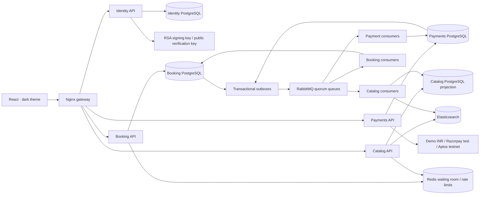

# TicketChain service architecture and interview walkthrough

TicketChain runs independently deployable Identity, Booking, Payments, and Catalog services behind the web gateway. Each service keeps its domain modules in its own source folder; its API and consumers reuse those modules. Each service has its own PostgreSQL database and login. See [service code layout](service-layout.md) for module responsibilities and entry points. No service queries another service's database.



## Ownership and consistency

Booking owns organizer event writes, tier pricing, inventory, holds, immutable order items, tickets, check-in, and refund eligibility. These remain one transaction boundary: splitting event mutations into a separate writer would weaken cancellation and inventory guarantees. Identity owns passwords, OAuth identities, refresh families, wallet challenges, and account capabilities. Booking keeps only a public account projection; it receives current account details from Identity over authenticated internal HTTP. Payments owns provider intents, captured identifiers, signed webhook evidence, reconciliation, and treasury submissions. Its order records are snapshots retrieved from Booking, never an inventory authority. Booking's provider records are financial projections used to make ticket fulfillment and refund acceptance transactional.

An organizer is also an attendee. Explicit onboarding adds organizer capability without replacing the account or its purchases. Identity signs 15-minute RSA access tokens; service APIs verify the public key and retrieve current active account/capability details. This adds an Identity dependency for private actions; scale Identity and its pool separately. JWT keys are generated once by bootstrap; only Identity mounts the private volume. Internal endpoints require a service credential and are blocked by Nginx.

Inventory units are reusable. Allocations retain history and a partial unique index permits only one active allocation per unit. Booking locks event, tiers in ID order, order, and inventory in ID order. Holds expire using PostgreSQL time. A successful hold decreases availability immediately; confirmed payment keeps inventory committed; expiry and eligible confirmed refunds restore it. Admission uses opaque single-use credentials and is blocked immediately upon refund acceptance or cancellation.

## Purchase and refund flow

```mermaid
sequenceDiagram
  participant User
  participant Booking
  participant BookingDB as Booking PostgreSQL
  participant Payments
  participant Broker as RabbitMQ
  participant Worker as Booking consumer
  User->>Booking: Reserve quantities + idempotency key + optional queue pass
  Booking->>BookingDB: Lock event/tiers, allocate all units, snapshot prices, schedule expiry, write outbox
  BookingDB-->>User: Held order (10 minutes)
  User->>Payments: Initialize payment
  Payments->>Booking: Read authoritative owned order and sellability
  Payments->>Payments: Persist provider intent; worker initializes provider
  User->>Payments: Submit checkout evidence
  Payments->>Payments: Verify amount, currency, association, capture; persist outcome + outbox
  Payments->>Broker: Confirmed persistent publication
  Broker->>Worker: payment.captured (at least once)
  Worker->>BookingDB: Lock event/order; allocate late payment or refund; issue tickets once
  Worker-->>Broker: Acknowledge after durable processing
  User->>Booking: Request full-order refund
  Booking->>BookingDB: Check eligibility; block admission; write refund command
  Booking->>Broker: refund.requested
  Broker->>Payments: Execute/reconcile refund
  Payments->>Broker: refund.confirmed
  Broker->>Worker: Finalize refund and restore eligible inventory
```

Payment confirmation returns `payment_pending` until Booking applies verified capture. The UI polls order state. Duplicate or older outcomes cannot issue extra tickets. A late captured payment receives a complete reallocation only while the event remains sellable; otherwise a full refund is queued. Check-in and refund acceptance share Booking's event/order locks. Financial uncertainty requires reconciliation rather than blind provider resubmission.

## Queue, cache, and search

PostgreSQL outboxes persist messages with domain changes. Publishers use persistent messages, mandatory routing, and confirms. Consumers acknowledge after idempotent durable processing and record completed message IDs. This is at-least-once delivery, with application deduplication; it does not claim exactly-once network delivery. Durable quorum queues retain work over broker restart. Invalid/unprocessable messages receive bounded redeliveries and end in service-specific dead-letter queues. Scheduled work remains in its owning database; leased schedulers publish due jobs, recover abandoned leases, and retain provider operation identifiers. Job failures have bounded backoff and visible manual review.

The optional waiting room uses a Redis FIFO sorted set and atomic Lua admission. Defaults: 10 passes per second, 50 active passes, two-minute pass expiry, and 45-second abandoned-visitor expiry. Joining again does not add another queue entry. A pass binds event, user, and one idempotency key; it permits an attempt, not guaranteed stock. Existing order retries bypass queue re-admission. Redis outages fail queued admission closed while existing order access continues. Distributed rate limits use Redis with a PostgreSQL fallback. Catalog cache failures do not prevent discovery.

Catalog indexes versioned Booking projections in Elasticsearch. Search supports title/description, category, city, date, availability, and stable sorting. Projection messages cannot overwrite newer versions. Catalog keeps a PostgreSQL fallback and a repeatable index rebuild command. Search availability is approximate; event details and checkout read Booking directly. Client availability polls every three seconds while visible. Cache entries expire after ten seconds and mutation projections advance the cache epoch.

## Scaling and measured limits

`compose.scale.yaml` demonstrates two replicas per API and two Booking/Payments consumers. Nginx resolves container DNS changes. PostgreSQL pools default to five connections per process; budget connections across APIs, workers, administration, and migrations. One hot event deliberately serializes allocation; unrelated events proceed concurrently. Larger scale can partition Booking by event ID, but one event must retain one authoritative transaction owner. Connection pooling and admission thresholds should follow measured capacity.

Local PostgreSQL, RabbitMQ, Redis, and Elasticsearch each run on one node. Quorum queues here demonstrate durable queue semantics, not multi-node high availability. Production requires a RabbitMQ cluster, database recovery/replication, Redis failover, replicated search shards, TLS, individual service credentials, secret management, and tested operational budgets. These are deployment tradeoffs, not measured local guarantees.

The contention reports use disposable ten-unit events at concurrency 10, 50, and 100 against the isolated database. They measure the Booking transaction path; they are not an end-to-end gateway throughput benchmark. Hardware, duration, outcomes, and latency accompany each result. The failure drill separately measures broker restart, paused consumer recovery, Redis failure, and search fallback.

## Interview demonstration

1. Open Profile, edit a display name, and enable organizer tools on the same account.
2. Publish an event; optionally enable its waiting room.
3. Show Redis admission, select quantities, reserve, and observe inventory decrease from another browser.
4. Pay using demo INR and explain provider intent, outbox, RabbitMQ, and eventual ticket issuance.
5. Check in once, then demonstrate repeated admission rejection.
6. Refund an unused order; show admission blocking before financial confirmation and subsequent inventory restoration.
7. Inspect queued/dead-letter work, run the recovery drill, and show measured contention evidence.
8. Explain database ownership, hot-event serialization, at-least-once delivery, projection staleness, and infrastructure failover requirements.

Optional Aptos collectibles remain independent of admission. No resale, seat map, marketplace payouts, or paid hosting is introduced.
